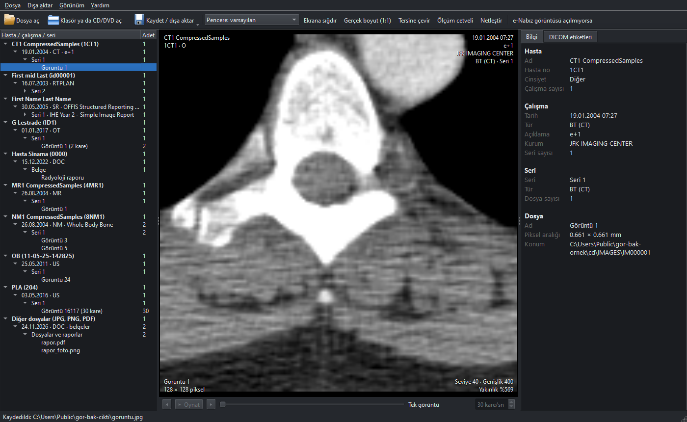
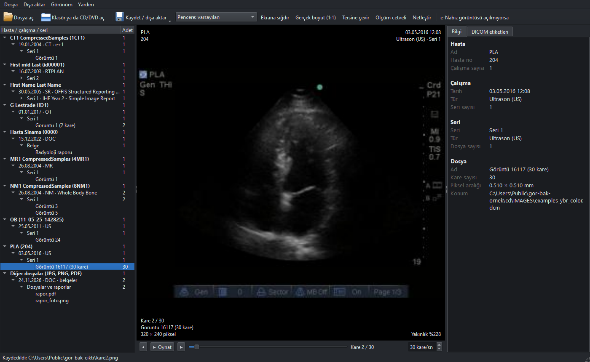

# gör-bak

**Türkçe** · [English](#english)

Windows için yerel radyoloji görüntüleyici. Röntgen, MR, BT, ultrason ve diğer DICOM görüntülerini açar, ayrıntılı inceler, PNG, JPG ya da PDF olarak kaydeder. İnternete bağlanmaz, dosyalar hiçbir yere gönderilmez.




*Ekran görüntülerindeki hastalar pydicom'un herkese açık test verisidir.*

## Ne açar

- DICOM: `.dcm`, uzantısız dosyalar, CD/DVD'deki `DICOMDIR`, zip içindeki DICOM'lar
- Sıkıştırılmış DICOM: JPEG (8/12 bit), JPEG-LS, JPEG 2000, RLE
- DICOM içine gömülü PDF raporlar ve yapılandırılmış raporlar (SR)
- JPG, PNG, BMP, TIFF ve PDF (ör. hastaneden alınan rapor)

## Ne yapar

- Çalışmaları hasta → çalışma (tarih, modalite: CR, DX, US, CT, MR…) → seri → görüntü düzeninde listeler
- Pencere/seviye: sağ tuşla sürükleme, BT için hazır ayarlar (akciğer, mediasten, kemik, beyin…), otomatik pencere
- Yakınlaştırma (tekerlek), kaydırma (sol tuş), ekrana sığdır, 1:1, tersine çevir, netleştir, tam ekran
- MR/BT serilerinde kesit kesit gezinme; çok kareli ultrason ve BT için oynatma ve hız ayarı
- Ölçüm cetveli (piksel aralığı varsa mm)
- Aranabilir DICOM etiketleri (sık kullanılanlar Türkçe)
- Dışa aktarma: ekrandaki görüntü (PNG/JPG/PDF), çalışma ya da seri (PDF ya da klasöre PNG/JPG), orijinal DICOM'ların değişmeden kopyalanması

## Kurulum

1. `gor-bak-<sürüm>.zip` paketini ([Releases](../../releases) sayfasından ya da `python araclar/paketle.py` ile) alıp bir klasöre çıkarın.
2. `Kur.cmd` dosyasına çift tıklayın. Program `%LOCALAPPDATA%\Programs\gor-bak` klasörüne kurulur; Masaüstüne ve Başlat menüsüne kısayol eklenir. Yönetici izni gerekmez.
3. Kaldırmak için Başlat menüsündeki **gör-bak kaldır** kısayolunu ya da Ayarlar > Uygulamalar'ı kullanın.

Exe imzalı olmadığı için Windows SmartScreen uyarı gösterebilir: **Ek bilgi → Yine de çalıştır**.

## e-Nabız'da görüntü açılmıyorsa

"Hastaneye erişim sorunu nedeniyle radyolojik görüntünüze ulaşılamamaktadır" mesajı, görüntünün hastanenin kendi arşivinde (PACS) durduğunu ve e-Nabız'ın o an bu arşive ulaşamadığını gösterir. gör-bak dahil hiçbir program görüntüyü oradan çekemez. Şunları yapabilirsiniz:

1. Görüntü yüklenen çalışmaları Teleradyoloji ekranındaki disk (kaydet) düğmesiyle indirin ve gör-bak'ta açın.
2. Hastaneden çalışmayı CD/DVD ya da DICOM dosyası olarak, raporu da çıktı ya da PDF olarak isteyin.
3. Daha sonra yeniden deneyin.

## Kaynaktan çalıştırma ve paketleme

```powershell
python -m pip install -r requirements.txt
python -m gorbak                    # programı aç
python tests/test_cekirdek.py       # çekirdek sınamaları
python araclar/paketle.py           # dagitim/gor-bak-<sürüm>.zip üretir
```

Kurulu exe'nin öz sınaması: `gor-bak.exe <klasör> --sinama-cikti <çıktı klasörü>`. Görüntüleri arayüzde açar, dışa aktarır ve sonucu `sinama.txt` dosyasına yazar.

Teknoloji: Python, PySide6 (Qt), pydicom, pylibjpeg, PyMuPDF, Pillow, PyInstaller.

**gör-bak tıbbi tanı aracı değildir.** Tanı için hekiminize ve orijinal görüntülere başvurun.

---

## English

gör-bak is a local radiology image viewer for Windows. It opens X-ray, MR, CT, ultrasound and other DICOM images, lets you inspect them in detail and exports them as PNG, JPG or PDF. It makes no network connections. The user interface is Turkish only.

- **Opens:** DICOM (`.dcm`, files without an extension, `DICOMDIR` from CDs/DVDs, DICOM inside zip files), including JPEG, JPEG-LS, JPEG 2000 and RLE compression. Also encapsulated PDF and SR reports, JPG, PNG, BMP, TIFF and PDF.
- **Viewer:** window/level (right-drag, CT presets, auto), zoom, pan, invert, sharpen, slice navigation for MR/CT series, cine playback for multi-frame US/CT, distance measurement in mm and a searchable DICOM tag browser.
- **Export:** the current view as PNG/JPG/PDF, a whole study or series as PDF or as a folder of PNG/JPG files, and unchanged copies of the original DICOM files.
- **Install:** download the zip from Releases, extract it and double-click `Kur.cmd`. It installs per user and needs no admin rights.
- **Build:** `python -m pip install -r requirements.txt`, then `python araclar/paketle.py`.

gör-bak is not a medical diagnostic device.
